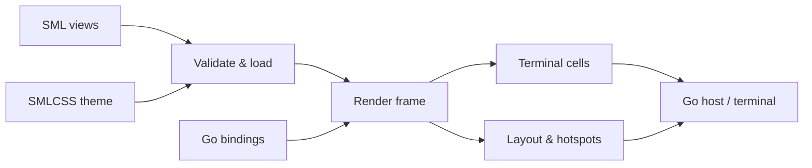

<div align="center">

# SML

### Build terminal interfaces with markup, not print statements.

**A declarative UI engine for Go, built for terminals and SSH.**

Write layouts in SML. Style them with SMLCSS. Connect them to your Go application.

No browser, JavaScript runtime, or embedded scripting engine required.

[](https://github.com/AmpedWasTaken/SML/actions/workflows/go.yml)
[](https://pkg.go.dev/github.com/AmpedWasTaken/SML)
[](go.mod)
[](LICENSE)

[Quick start](#quick-start) · [SMLCSS](#style-your-ui-with-smlcss) · [Components](docs/components.md) · [Go API](docs/go-api.md) · [Examples](examples/) · [Roadmap](docs/roadmap.md)

</div>

---

SML brings the familiar separation of **markup, styling, and application logic** to terminal applications. Instead of manually drawing boxes, calculating positions and matching mouse coordinates in Go, describe your interface and let SML render it.

```text
╭ Service status ──────────────────────╮
│ [OK] Online                          │
│ Requests: 4242                       │
╰──────────────────────────────────────╯
```

The markup behind this panel:

```xml
<screen name="home" version="3">
    <panel title="Service status">
        <badge tone="success" variant="minimal">Online</badge>
        <field label="Requests" key="app.requests"/>
    </panel>
</screen>
```

The Go application supplies `app.requests`. Change the value and render again; the layout stays separate from application logic.

## Why SML?

- **Declarative layouts:** panels, responsive grids, weighted columns and reusable components.
- **Native styling:** rounded and double-line borders, shared styles, design tokens, gradients and optional ANSI truecolor.
- **Interactive controls:** buttons, inputs, choices, toggles and cell-accurate hitboxes.
- **Data-driven views:** bindings, conditions, loops, derived values, tables and charts.
- **Efficient rendering tools:** frame differences, binding dependency metadata, scrollable frame windows and validated asset reloads.
- **Lightweight:** Go standard library plus `uniseg` for Unicode grapheme handling. MIT licensed.

Build monitoring dashboards, developer tools, SSH interfaces, admin panels and custom Go TUIs.

SML is a **view engine**, not a full application framework. Your Go host owns the terminal session, keyboard and mouse events, application state, authorization and redraw scheduling.

## Quick start

### Try SML in your terminal

Requires **Go 1.23+**.

```bash
git clone https://github.com/AmpedWasTaken/SML.git
cd SML
go run ./cmd/sml render -width 70 -set app.health=online -set app.requests=4242 -set app.errors=3 -set app.cpu=37 examples/quickstart.sml
```

The CLI prints rendered terminal lines. It does not start a full-screen event loop.

### Embed SML in your own Go project

```bash
go get github.com/AmpedWasTaken/SML
```

```go
package main

import (
    "fmt"
    "log"
    "strings"

    "github.com/AmpedWasTaken/SML"
)

func main() {
    view, err := sml.Parse([]byte(`
        <screen name="home" version="3">
            <panel title="Service status">
                <badge tone="success" variant="minimal">Online</badge>
                <field label="Requests" key="app.requests"/>
            </panel>
        </screen>
    `))
    if err != nil {
        log.Fatal(err)
    }

    frame, err := view.RenderFrame(map[string]string{
        "app.requests": "4242",
    }, 40)
    if err != nil {
        log.Fatal(err)
    }

    fmt.Println(strings.Join(frame.Lines, "\n"))
}
```

Save this as `main.go` in your Go module and run `go run .`.

## How it works



1. **Define:** write screens and reusable components in `.sml` files.
2. **Style:** set visual attributes or load a shared SMLCSS theme.
3. **Bind:** provide application data from Go. For example, `{{app.requests}}` reads a host-supplied value.
4. **Render:** generate a frame at the current terminal width.
5. **Interact:** handle input and authorize actions in your Go application. Re-render when state changes.

A frame exposes terminal lines, a Unicode cell matrix, layout bounds and hotspots. The engine never executes application commands or grants permissions.

## Style your UI with SMLCSS

SMLCSS is a small CSS-inspired language designed for terminal interfaces. Put a `styles.smlcss` file next to your project's `views/` directory.

```css
:root {
    --edge: round;
    --space: 1;
}

panel {
    border: var(--edge);
    padding: var(--space);
}

button { border: var(--edge); }
input  { border: var(--edge); }
choice { border: var(--edge); }
toggle { border: var(--edge); }
table  { style: rounded; }

.important { border: double; }
.classic   { border: ascii; }
```

Write your view without repeating every style:

```xml
<screen name="home" version="3">
    <panel title="Workspace" class="important">
        <input label="Name" key="state.name"/>
        <choice label="Layout" key="state.layout"
                options="Compact,Wide"/>
        <button label="Status" command="status"/>
        <button label="Help" command="help" class="classic"/>
    </panel>
</screen>
```

| Rounded | Double | ASCII |
| --- | --- | --- |
| Normal components | Important containers | Compatibility style |
| `border="round"` | `border="double"` | `border="ascii"` |

Component defaults are applied first, classes from left to right, and explicit inline attributes last. Use `border="none"` to retain an unframed control.

SMLCSS supports component selectors, classes, comments, `:root` tokens and `var(--token)`. It intentionally does not implement browser CSS, imports, scripts or pseudo-selectors. The existing `styles.json` format remains supported; use one stylesheet format per asset root.

[Theme example](examples/theme/) · [Styling reference](docs/components.md#global-terminal-styles-with-smlcss)

## Explore the language

| Category | Components |
| --- | --- |
| Layout | `screen`, `box`, `row`, `column`, `grid`, `panel`, `section`, `spacer`, `divider` |
| Content | `text`, `badge`, `alert`, `field`, `metric`, `banner` |
| Data and charts | `table`, `progress`, `gauge`, `sparkline`, `heatmap`, `bar-chart`, `stacked-bar`, `waveform`, `kpi`, `activity-feed` |
| Controls | `button`, `link`, `input`, `number`, `choice`, `toggle`, `plugin-action` |
| Logic | `if`, `when`, `otherwise`, `empty`, `repeat`, `derive` |
| Reusable views | `component`, `include`, `use`, `slot`, `fill` |
| Appearance | Inline styles, local text-cell images and GIFs, gradients, panel/table glow |

### Responsive layouts and bindings

```xml
<screen name="dashboard" version="3">
    <grid columns="2" weights="1,2" gap="2" collapse-below="60">
        <panel title="Overview">
            <metric label="Requests" value="{{app.requests}}"/>
            <progress label="CPU" value="{{app.cpu}}"/>
        </panel>
        <panel title="Health">
            <if field="app.health" equals="online">
                <badge tone="success">Online</badge>
                <otherwise>
                    <alert tone="warning">Unavailable</alert>
                </otherwise>
            </if>
            <button id="refresh" label="Refresh" action="app.refresh"/>
        </panel>
    </grid>
</screen>
```

The structural frame renderer distributes terminal cells by column weights and stacks panels when the available width is too small. The Go host provides data and handles the refresh action.

### Interactive frames

```go
frame, err := view.RenderFrame(bindings, terminalWidth)
if err != nil {
    return err
}

if spot, ok := frame.HitTest(mouseX, mouseY); ok {
    // Authorize and handle spot.Action in your application.
    _ = spot.Action
}
```

Coordinates use terminal display cells rather than bytes or rune counts. Use `frame.Window(...)` for clipped viewports and `sml.DiffFrames(before, after)` for cell-level updates. For color-capable clients, `sml.PaintGlowFrame(frame, sml.GlowOptions{TrueColor: true})` provides optional ANSI color effects without changing frame geometry.

See [Go integration](docs/go-api.md) and [layout geometry](docs/layout.md).

## Organize your project

```text
my-app/
├── main.go
└── assets/
    ├── styles.smlcss
    ├── views/
    │   ├── home.sml
    │   └── dashboard.sml
    ├── components/
    │   └── header.sml
    ├── art/
    └── media/
```

Load the entire asset directory to resolve shared styles and components:

```go
views, err := sml.LoadDir("assets")
if err != nil {
    return err
}

frame, err := views["home"].RenderFrame(bindings, 80)
if err != nil {
    return err
}
// Paint frame.Lines or frame.Cells in your terminal host.
_ = frame
```

For reloadable assets, use `sml.NewAssetStore("assets", "home")`. Calling `Reload()` explicitly publishes a validated revision and retains the last working snapshot if validation fails.

## Documentation

| Guide | What you'll learn |
| --- | --- |
| [Language reference](docs/language.md) | Syntax, bindings, conditions, repetition and versions |
| [Component reference](docs/components.md) | Widgets, layout and styling |
| [Go API](docs/go-api.md) | Parsing, rendering, interaction and asset loading |
| [Layout](docs/layout.md) | Unicode cells, responsive geometry and stable control IDs |
| [Frame differences](docs/frame-diffs.md) | Incremental rendering |
| [Typed bindings](docs/typed-bindings.md) | Typed presentation values and state |
| [CLI](docs/cli.md) | Render and validate your SML files |
| [Examples](examples/) | Sample views and Go integrations |
| [Architecture](docs/architecture.md) | Parser, renderer, host boundaries and limitations |
| [Security](docs/security.md) | Validation, resource limits and trust boundaries |
| [Roadmap](docs/roadmap.md) | Future improvements and contribution opportunities |

## Project status

SML originated as the view engine for [Sentinel V5](https://github.com/AmpedWasTaken/Sentinel-V5) and is available as a standalone Go library. It contains no Sentinel authentication, backend services or plugin execution logic.

The library supports SML v1–v3 and is under active development. Pin a known-good commit for production integrations until the first stable release. Terminal/font compatibility and authorization remain the host's responsibility.

## Contribute

Have an idea for a component, a rendering improvement or a new example? Contributions are welcome.

```bash
go test ./...
go vet ./...
```

See [CONTRIBUTING.md](CONTRIBUTING.md), [good first issues](https://github.com/AmpedWasTaken/SML/issues?q=is%3Aissue%20is%3Aopen%20label%3A%22good%20first%20issue%22) and the [roadmap](docs/roadmap.md). For rendering bugs, include a small SML example and terminal dimensions. See [SECURITY.md](SECURITY.md) for vulnerability reporting.

---

<div align="center">

**Like the idea of building terminal UIs with markup?**

[Give SML a star on GitHub](https://github.com/AmpedWasTaken/SML) to support the project and follow its development.

MIT © 2026 [AmpedWasTaken](https://github.com/AmpedWasTaken) · [License](LICENSE) · [Changelog](CHANGELOG.md)

</div>
